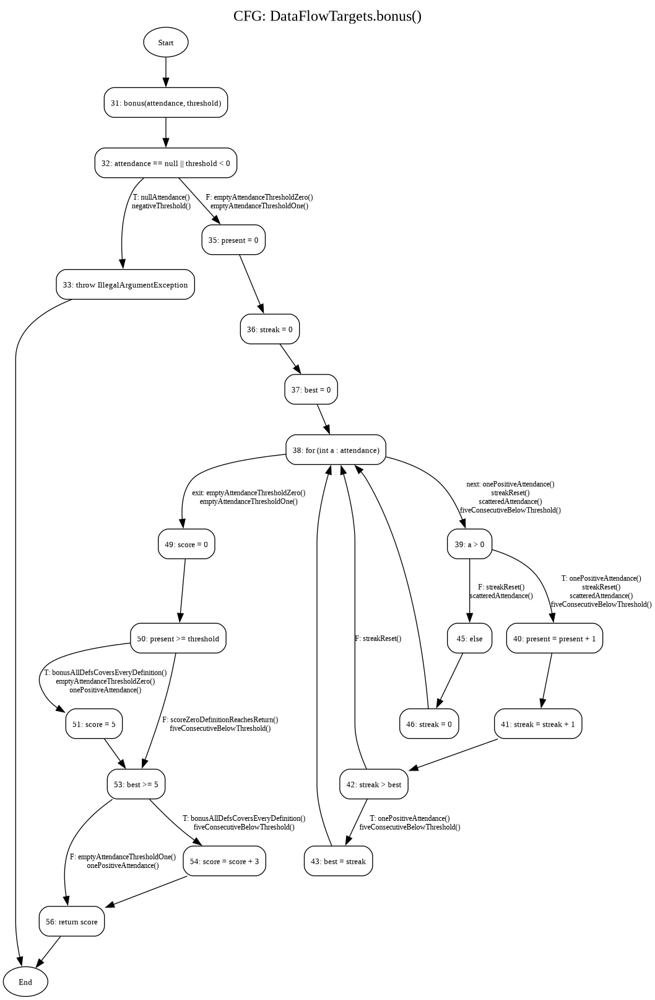

k# Лаборатори №10 — Өгөгдлийн урсгалын тест (Definition-Use Pairs)

**Оюутны нэр:** Тэргэл  
**Оюутны код:** B232270011  
**Төслийн хэл:** Java 17  
**Build tool:** Maven 3.10.0  
**OS:** Arch Linux

## 1. Java болон Maven орчны мэдээлэл

`java -version` командын гаралт:

```text
openjdk version "17.0.21.0.3" 2026-10-24
OpenJDK Runtime Environment (build 17.0.21.0.3+1)
OpenJDK 64-Bit Server VM (build 17.0.21.0.3+1, mixed mode, sharing)
```

`mvn -version` командын гаралт:

```text
Apache Maven 3.10.0 (c43a36b8d67be7e0805a411bc0898af1a51f5472)
Maven home: /usr/share/java/maven
Java version: 17.0.21.0.3, vendor: Arch Linux, runtime: /usr/lib/jvm/java-17-openjdk
Default locale: en_US, platform encoding: UTF-8, time zone: Asia/Ulaanbaatar
OS name: "linux", version: "7.2.11-arch1-1", arch: "amd64"
```

## 2. Лабораторийн зорилго

Энэ лабораторийн ажлаар `DataFlowTargets` классын `gcd()` болон `bonus()` функцүүдэд өгөгдлийн урсгалын анализ хийв.

Хувьсагч бүрийн Definition (Def), Computational Use (C-use), Predicate Use (P-use), Kill болон Definition-Use (DU) хосуудыг тодорхойлж, All-Defs болон All-DU-Pairs тестүүдийг боловсруулав.

Мөн Control Flow Graph (CFG), mutation testing болон JaCoCo coverage ашиглан тестийн үр дүнг шалгав.

## 3. Эх код

Эх кодын файл:

`src/main/java/mn/edu/must/sqat/DataFlowTargets.java`

**Анхааруулга:** Өгөгдсөн `DataFlowTargets.java` эх кодыг өөрчлөөгүй. Анализ хийхэд ашигласан мөрийн дугаарууд эх кодтой таарч байгаа.

## 4. GCD функцийн DU анализ

GCD функцийн эх код:

```java
public static int gcd(int x, int y) {
    int tmp;
    while (y != 0) {
        tmp = x % y;
        x = y;
        y = tmp;
    }
    return x;
}
```

### 4.1 Definition болон Use

| Хувьсагч | Definition | Use | Төрөл |
|---|---:|---:|---|
| `x` | 13 | 16 | C-use |
| `x` | 13 | 20 | C-use |
| `x` | 17 | 16 | C-use |
| `x` | 17 | 20 | C-use |
| `y` | 13 | 15 | P-use |
| `y` | 13 | 16 | C-use |
| `y` | 13 | 17 | C-use |
| `y` | 18 | 15 | P-use |
| `y` | 18 | 16 | C-use |
| `y` | 18 | 17 | C-use |
| `tmp` | 16 | 18 | C-use |

### 4.2 GCD-ийн def-clear зам болон тест

| Хувьсагч | Def → Use | Def-clear зам | Тест |
|---|---|---|---|
| `x` | 13 → 16 | 13 → 14 → 15(T) → 16 | `gcdWithMultipleIterations` |
| `x` | 13 → 20 | 13 → 14 → 15(F) → 20 | `gcdWithZeroSecondArgument` |
| `x` | 17 → 16 | 17 → 18 → 15(T) → 16 | `gcdWithMultipleIterations` |
| `x` | 17 → 20 | 17 → 18 → 15(F) → 20 | `gcdWithMultipleIterations` |
| `y` | 13 → 15 | 13 → 14 → 15 | `gcdWithMultipleIterations`, `gcdWithZeroSecondArgument` |
| `y` | 13 → 16 | 13 → 14 → 15(T) → 16 | `gcdWithMultipleIterations` |
| `y` | 13 → 17 | 13 → 14 → 15(T) → 16 → 17 | `gcdWithMultipleIterations` |
| `y` | 18 → 15 | 18 → 19 → 15 | `gcdWithMultipleIterations` |
| `y` | 18 → 16 | 18 → 19 → 15(T) → 16 | `gcdWithMultipleIterations` |
| `y` | 18 → 17 | 18 → 19 → 15(T) → 16 → 17 | `gcdWithMultipleIterations` |
| `tmp` | 16 → 18 | 16 → 17 → 18 | `gcdWithMultipleIterations` |

`gcdWithZeroSecondArgument()` тест нь `gcd(7, 0)` оролттой. `while (y != 0)` нөхцөл эхний шалгалтаар худал болж, 20-р мөрөнд `x`-ийн анхны утга ашиглагдана.

`gcdWithMultipleIterations()` тест нь `gcd(12, 8)` оролттой. Энэ тест давталтын эхний болон дараагийн iteration-ууд дахь `x`, `y`, `tmp` хувьсагчдын DU хамаарлыг шалгана.

Тестийн DisplayName-д заасан ID:
- `A2`, `A6`: `gcd(7, 0)`
- `A1`, `A3–A5`, `A7–A13`: `gcd(12, 8)`

## 5. Bonus функцийн Control Flow Graph

Bonus функцийн CFG зураг:



CFG-ийн эх файл: `results/cfg-bonus.dot`

CFG-д дараах үндсэн салааллууд байна:

- 32-р мөр: оролтын параметрүүдийг шалгах.
- 38-р мөр: attendance массивын давталт.
- 39-р мөр: ирц эерэг эсэх.
- 42-р мөр: streak нь best-ээс их эсэх.
- 50-р мөр: present нь threshold-д хүрсэн эсэх.
- 53-р мөр: best нь 5-аас багагүй эсэх.

## 6. Bonus функцийн Definition / Use анализ

### 6.1 Def/Use жагсаалт

| Мөр | Үйлдэл | Definition | Use |
|---:|---|---|---|
| 31 | `bonus(int[] attendance, int threshold)` | `attendance`, `threshold` | — |
| 32 | `attendance == null || threshold < 0` | — | `attendance`, `threshold` (P-use) |
| 35 | `int present = 0` | `present` | — |
| 36 | `int streak = 0` | `streak` | — |
| 37 | `int best = 0` | `best` | — |
| 38 | `for (int a : attendance)` | `a` | `attendance` (C-use) |
| 39 | `if (a > 0)` | — | `a` (P-use) |
| 40 | `present = present + 1` | `present` | `present` (C-use) |
| 41 | `streak = streak + 1` | `streak` | `streak` (C-use) |
| 42 | `if (streak > best)` | — | `streak`, `best` (P-use) |
| 43 | `best = streak` | `best` | `streak` (C-use) |
| 46 | `streak = 0` | `streak` | — |
| 49 | `int score = 0` | `score` | — |
| 50 | `if (present >= threshold)` | — | `present`, `threshold` (P-use) |
| 51 | `score = 5` | `score` | — |
| 53 | `if (best >= 5)` | — | `best` (P-use) |
| 54 | `score = score + 3` | `score` | `score` (C-use) |
| 56 | `return score` | — | `score` (C-use) |

### 6.2 Хувьсагч тус бүрийн Definition болон Use

| Хувьсагч | Definition мөр | Use мөр |
|---|---|---|
| `attendance` | 31 | 32(P), 38(C) |
| `threshold` | 31 | 32(P), 50(P) |
| `a` | 38 | 39(P) |
| `present` | 35, 40 | 40(C), 50(P) |
| `streak` | 36, 41, 46 | 41(C), 42(P), 43(C) |
| `best` | 37, 43 | 42(P), 53(P) |
| `score` | 49, 51, 54 | 54(C), 56(C) |

`a` хувьсагчийн 40-р мөрөнд use байхгүй. 40-р мөрөнд зөвхөн `present` болон түүний өмнөх утгыг ашигладаг.

## 7. Bonus функцийн DU хосууд

Доорх хүснэгтэд DU хос бүрийн definition, use, use-ийн төрөл, def-clear зам болон холбогдох тестийг харуулав.

Тестийн ID:
- `B-AD1`, `B-AD2`: `BonusAllDefsTest`
- `DU1`–`DU8`: `BonusAllDUPairsTest`
- `M2-KILL`: `BonusM2MutationTest`

### 7.1 attendance

| Def → Use | Төрөл | Def-clear зам | Тест |
|---|---|---|---|
| 31 → 32 | P-use | 31 → 32 | DU1, DU2, DU3 |
| 31 → 38 | C-use | 31 → 32(F) → 35 → 36 → 37 → 38 | DU3, DU5 |

### 7.2 threshold

| Def → Use | Төрөл | Def-clear зам | Тест |
|---|---|---|---|
| 31 → 32 | P-use | 31 → 32 | DU1, DU2 |
| 31 → 50 | P-use | 31 → 32(F) → 35 → 36 → 37 → 38(F) → 49 → 50 | DU3, DU4 |

### 7.3 a

| Def → Use | Төрөл | Def-clear зам | Тест |
|---|---|---|---|
| 38 → 39 | P-use | 38 → 39 | DU5, DU6, DU7, DU8 |

`38 → 40` нь DU хос биш. Учир нь 40-р мөрөнд `a` хувьсагч ашиглагдахгүй.

### 7.4 present

| Def → Use | Төрөл | Def-clear зам | Тест |
|---|---|---|---|
| 35 → 40 | C-use | 35 → 38 → 39(T) → 40 | DU5 |
| 35 → 50 | P-use | 35 → 38(F) → 49 → 50 | DU3, DU4 |
| 40 → 40 | C-use | 40 → 38 → 39(T) → 40 | B-AD1, DU7 |
| 40 → 50 | P-use | 40 → 38(F) → 49 → 50 | B-AD1, DU8 |

### 7.5 streak

| Def → Use | Төрөл | Def-clear зам | Тест |
|---|---|---|---|
| 36 → 41 | C-use | 36 → 37 → 38 → 39(T) → 40 → 41 | DU5 |
| 41 → 41 | C-use | 41 → 42(T/F) → 38 → 39(T) → 40 → 41 | DU8 |
| 41 → 42 | P-use | 41 → 42 | DU5, DU8 |
| 41 → 43 | C-use | 41 → 42(T) → 43 | DU5, DU8 |
| 46 → 41 | C-use | 46 → 47 → 38 → 39(T) → 40 → 41 | DU6 |

### 7.6 best

| Def → Use | Төрөл | Def-clear зам | Тест |
|---|---|---|---|
| 37 → 42 | P-use | 37 → 38 → 39(T) → 40 → 41 → 42 | DU5 |
| 37 → 53 | P-use | 37 → 38(F) → 49 → 50 → 53 | DU3, DU4 |
| 43 → 42 | P-use | 43 → 44 → 38 → 39(T) → 40 → 41 → 42 | DU8 |
| 43 → 53 | P-use | 43 → 44 → 38(F) → 49 → 50 → 53 | B-AD1, DU8 |

### 7.7 score

| Def → Use | Төрөл | Def-clear зам | Тест |
|---|---|---|---|
| 49 → 54 | C-use | 49 → 50(F) → 53(T) → 54 | DU8 |
| 49 → 56 | C-use | 49 → 50(F) → 53(F) → 56 | DU4 |
| 51 → 54 | C-use | 51 → 52 → 53(T) → 54 | B-AD1 |
| 51 → 56 | C-use | 51 → 52 → 53(F) → 56 | DU5 |
| 54 → 56 | C-use | 54 → 55 → 56 | B-AD1, DU8 |

### 7.8 P-use-ийн T/F зам ба тест

| Нөхцөл | True зам | False зам | Холбогдох тест |
|---|---|---|---|
| 32: `attendance == null` | IllegalArgumentException | Дараагийн нөхцөл рүү | DU1 |
| 32: `threshold < 0` | IllegalArgumentException | Эхний шалгалт худал, функц үргэлжилнэ | DU2, DU3 |
| 39: `a > 0` | 40-р мөр рүү | 46-р мөр рүү | DU5, DU6 |
| 42: `streak > best` | 43-р мөр рүү | 44-р мөр рүү | DU5, DU8 |
| 50: `present >= threshold` | 51-р мөр рүү | 53-р мөр рүү | DU3, DU4, B-AD1 |
| 53: `best >= 5` | 54-р мөр рүү | 56-р мөр рүү | DU4, DU5, DU8 |

32-р мөрөнд Java-ийн short-circuit `||` үйлдэл ашиглагдсан. `attendance == null` үнэн бол `threshold < 0` нөхцөлийг үнэлэхгүй.

## 8. Kill болон боломжгүй DU хосууд

### 8.1 Kill үйлдлүүд

| Мөр | Хувьсагч | Kill-ийн тайлбар |
|---:|---|---|
| 40 | `present` | Өмнөх `present` definition-ийг шинэ утгаар дарна |
| 41 | `streak` | Өмнөх `streak` definition-ийг шинэ утгаар дарна |
| 43 | `best` | Өмнөх `best` definition-ийг шинэ утгаар дарна |
| 46 | `streak` | Өмнөх `streak` definition-ийг 0 болгож шинэчилнэ |
| 51 | `score` | Өмнөх `score` definition-ийг 5 болгож дарна |
| 54 | `score` | Өмнөх `score` definition-ийг шинэ нийлбэрээр дарна |

### 8.2 DU хос биш буюу def-clear биш замууд

| Хувьсагчийн хос | Яагаад DU хос биш вэ? |
|---|---|
| `a`: 38 → 40 | 40-р мөрөнд `a` ашиглагдахгүй |
| `streak`: 36 → 42 | 42-р мөрөнд хүрэхийн өмнө 41-р мөрөнд `streak` дахин тодорхойлогдоно |
| `streak`: 36 → 43 | 43-р мөрөнд хүрэхийн өмнө 41-р мөрөнд `streak` дахин тодорхойлогдоно |
| `present`: 35 → 50, 40-р мөрөөр дамжих | 40-р мөр `present`-ийг дахин тодорхойлж, 35-р мөрийн definition-ийг kill хийнэ |
| `best`: 37 → 53, 43-р мөрөөр дамжих | 43-р мөр `best`-ийг дахин тодорхойлно |
| `score`: 49 → 56, 51-р мөрөөр дамжих | 51-р мөр `score`-ийг дахин тодорхойлно |
| `score`: 49 → 56, 54-р мөрөөр дамжих | 54-р мөр `score`-ийг дахин тодорхойлно |

**Анхаарах зүйл:** `best` 37 → 53 нь өөрөө боломжтой DU хос. Жишээ нь хоосон массив эсвэл бүх элемент нь 0 үед 43-р мөр ажиллахгүй тул 37-р мөрийн definition 53-р мөрөнд хүрнэ. Харин 43-р мөрөөр дамжсан зам нь def-clear биш.

## 9. All-Defs тестүүд

Тестийн файл:

`src/test/java/mn/edu/must/sqat/BonusAllDefsTest.java`

| Тест | Оролт | Хүлээгдэж буй үр дүн | Зорилго |
|---|---|---:|---|
| B-AD1 | `{1,1,0,1,1,1,1,1}`, threshold=7 | 8 | Эерэг ирц, streak, best болон score-ийн эерэг definition-үүд |
| B-AD2 | `{}`, threshold=1 | 0 | present=0, best=0, score=0 definition-үүд |

### 9.1 Яагаад хамгийн багадаа 2 тест шаардлагатай вэ?

All-Defs шалгуураар `score` хувьсагчийн 49-р мөрийн `score = 0` болон 51-р мөрийн `score = 5` гэсэн хоёр өөр definition-ийг хамруулах шаардлагатай.

- 49-р мөрийн definition-ийг 56-р мөр хүртэл хадгалахын тулд 50-р мөрийн нөхцөл худал байх ёстой.
- 51-р мөрийн definition-ийг хамруулахын тулд 50-р мөрийн нөхцөл үнэн байх ёстой.
- Нэг удаагийн функцийн ажиллалтаар 50-р мөрийн нөхцөл зэрэг үнэн болон худал байх боломжгүй.

Иймээс эдгээр хоёр definition-ийг хамруулахын тулд дор хаяж хоёр өөр тест шаардлагатай.

### 9.2 All-Defs үр дүн

`results/mvn-verify-alldefs.txt` файлын үр дүн:

- Tests run: 4
- Failures: 0
- Errors: 0
- BUILD SUCCESS

`results/jacoco-alldefs.csv`:

| Үзүүлэлт | Covered | Missed | Нийт |
|---|---:|---:|---:|
| Instructions | 73 | 8 | 81 |
| Branches | 14 | 2 | 16 |
| Lines | 22 | 2 | 24 |

Branch coverage: 14/16 = 87.5%.

All-Defs нь бүх definition-ээс дор хаяж нэг use хүрэхийг шалгадаг. Энэ нь бүх branch-ийг хамруулахтай ижил шалгуур биш.

## 10. All-DU-Pairs тестүүд

Тестийн файл:

`src/test/java/mn/edu/must/sqat/BonusAllDUPairsTest.java`

| Тест | Метод | Зорилго |
|---|---|---|
| DU1 | `nullAttendance()` | null оролтын алдааны зам |
| DU2 | `negativeThreshold()` | Сөрөг threshold-ийн алдааны зам |
| DU3 | `emptyAttendanceThresholdZero()` | Хоосон массив, threshold=0 |
| DU4 | `emptyAttendanceThresholdOne()` | Хоосон массив, score=0 definition return-д хүрэх |
| DU5 | `onePositiveAttendance()` | Эерэг ирцийн эхний iteration |
| DU6 | `streakReset()` | Тасалсны дараах streak reset |
| DU7 | `scatteredAttendance()` | Тасалдсан эерэг ирцүүд |
| DU8 | `fiveConsecutiveBelowThreshold()` | Дараалсан 5 ирц, threshold-д хүрээгүй нөхцөл |

M2 mutation-ийг илрүүлэх нэмэлт тест:

`src/test/java/mn/edu/must/sqat/BonusM2MutationTest.java`

Метод: `totalAttendanceMustNotReplaceBestStreak()`

Оролт: `{1, 1, 1, 0, 1, 1, 1, 1}`, threshold=7.

Хүлээгдэж буй үр дүн: 5.

Энэ тест нийт ирцийн тоог хамгийн урт дараалсан ирцтэй андуурсан mutation-ийг илрүүлнэ.

### 10.1 All-DU-Pairs coverage

`results/jacoco-alldupairs.csv`:

| Үзүүлэлт | Covered | Missed | Нийт |
|---|---:|---:|---:|
| Instructions | 78 | 3 | 81 |
| Branches | 16 | 0 | 16 |
| Lines | 23 | 1 | 24 |

Branch coverage: 16/16 = 100%.

### 10.2 Branch coverage 100% байсан ч DU pair яагаад дутуу байж болох вэ?

Branch coverage нь нөхцөл бүрийн true болон false үр дүнг шалгадаг. Харин DU-pair coverage нь тодорхой definition-ээс тодорхой use хүртэлх def-clear замыг шалгадаг.

Жишээ нь 41-р мөрийн `streak = streak + 1` definition-ээс 42-р мөрийн `streak > best` predicate use хүртэлх DU хосыг авч үзье. 42-р мөрийн true болон false салааг бусад тестээр хамруулсан байсан ч 41-р мөрийн тодорхой definition-ээс уг use хүртэлх замыг шалгасан эсэхийг branch coverage дангаараа батлахгүй.

Тиймээс Branch coverage 100% байх нь бүх DU хос хамрагдсан гэсэн үг биш.

## 11. Mutation testing

Mutation testing-ээр эх кодод түр өөрчлөлт оруулж, тестүүд алдааг илрүүлж чадаж байгаа эсэхийг шалгав. Туршилт бүрийн дараа эх кодыг `git restore` ашиглан сэргээсэн.

| Mutation | Өөрчлөлт | Үр дүн | Тайлбар |
|---|---|---|---|
| M1 | `streak = streak + 1` мөрийг устгах | Killed | Тестүүд хүлээгдэж буй утгаас өөр үр дүн авсан |
| M2 | `best = streak`-ийг `best = present` болгох | Эхний 12 тестээр survived | Эхний тестүүд энэ алдааг илрүүлээгүй |
| M2-KILL | Нэмэлт `BonusM2MutationTest` | Killed | Expected 5 but was 8 |
| M3 | Ашиглагдахгүй `int total = present + best;` definition нэмэх | Survived | Үр дүн өөрчлөгдөөгүй тул функциональ тестүүд илрүүлээгүй |

### 11.1 M2-ийн нэмэлт тест

M2 mutation-ийг эхний 12 тест илрүүлээгүй. Иймээс дараах тестийг нэмсэн:

```java
int[] attendance = {1, 1, 1, 0, 1, 1, 1, 1};
assertEquals(5, DataFlowTargets.bonus(attendance, 7));
```

Энд нийт ирц 7 боловч хамгийн урт дараалсан ирц 4 байна. Зөв үр дүн 5 байх ёстой. Харин `best = present` mutation хийсэн үед 8 болж, тест унасан.

### 11.2 M3-ийг ямар багаж илрүүлж болох вэ?

M3 нь ашиглагдахгүй хувьсагчийн definition буюу dead assignment юм. Энэ өөрчлөлт функцийн буцаах утгыг өөрчлөхгүй тул ердийн JUnit функциональ тестээр илрүүлэхгүй байж болно.

Ийм төрлийн кодын асуудлыг static analysis хэрэгслээр шалгаж болно. Жишээ нь **PMD-ийн `UnusedAssignment` дүрэм** нь ашиглагдахгүй assignment-уудыг илрүүлэхэд зориулагдсан.

PMD-ийн шалгалтыг ажиллуулаагүй бол түүний үр дүнг баталгаажсан гэж үзэхгүй. M3 mutation-ийн хувьд энэ нь тестээр илрээгүй unused definition болохыг тэмдэглэв.

Mutation-ийн үр дүнгийн файлууд:

- `results/mvn-test-M1.txt`
- `results/mvn-test-M2.txt`
- `results/mvn-test-M2-kill.txt`
- `results/mvn-test-M3.txt`

## 12. Final verification

Final шалгалтыг эх кодыг анхны хувилбарт сэргээсний дараа ажиллуулсан.

Команд:

```bash
mvn clean verify
```

`results/mvn-verify-final.txt` үр дүн:

- Tests run: 13
- Failures: 0
- Errors: 0
- Skipped: 0
- BUILD SUCCESS

### 12.1 Final JaCoCo coverage

`results/jacoco-final.csv`:

| Үзүүлэлт | Covered | Missed | Нийт |
|---|---:|---:|---:|
| Instructions | 78 | 3 | 81 |
| Branches | 16 | 0 | 16 |
| Lines | 23 | 1 | 24 |

- Branch coverage: 100%
- Line coverage: 95.8%
- Instruction coverage: 96.3%

Үлдсэн нэг missed line нь implicit constructor-той холбоотой.

## 13. Үр дүнгийн файлууд

`results/` хавтсанд дараах файлууд хадгалагдсан:

```text
results/
├── cfg-bonus.dot
├── cfg-bonus.png
├── jacoco-alldefs.csv
├── jacoco-alldupairs.csv
├── jacoco-final.csv
├── mvn-test-M1.txt
├── mvn-test-M2.txt
├── mvn-test-M2-kill.txt
├── mvn-test-M3.txt
├── mvn-verify-alldefs.txt
├── mvn-verify-alldupairs.txt
└── mvn-verify-final.txt
```

## 14. Дүгнэлт

Энэ лабораторийн ажлаар `gcd()` болон `bonus()` функцүүдэд өгөгдлийн урсгалын анализ хийж, хувьсагчдын Definition, C-use, P-use, Kill болон DU хосуудыг тодорхойлов.

All-Defs болон All-DU-Pairs тестүүдийг тусад нь боловсруулж, mutation testing ашиглан тестийн илрүүлэх чадварыг шалгав. M2 mutation-ийг илрүүлэх нэмэлт тест нэмж, M1 болон M2 mutation-ийг амжилттай илрүүлсэн. M3 нь unused definition тул функциональ тестээр илрээгүй.

Final `mvn clean verify` амжилттай ажиллаж, 13 тест бүгд тэнцсэн. JaCoCo-ийн final Branch coverage 100% болсон.

Эх кодын `DataFlowTargets.java` файлыг анхны хувилбарт хэвээр хадгалсан.

